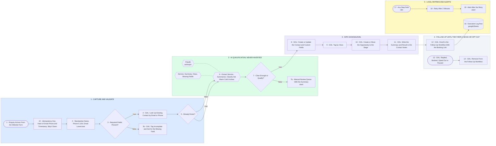

# Your Enquiry to Booked System

- **1 - CAPTURE AND VALIDATE** - One form, one webhook. Every enquiry is de-duplicated, standardized and checked against GoHighLevel before anything is created.
- **2 - AI QUALIFICATION, NEVER INVENTED** - Claude extracts the service, summarizes the enquiry and classifies it. Anything it cannot read is flagged, not guessed.
- **3 - INTO GOHIGHLEVEL** - Contact, custom fields, tags, opportunity stage and notes. Sales opens one record and sees the whole enquiry.
- **4 - FOLLOW UP UNTIL THEY REPLY, BOOK OR OPT OUT** - Approved messaging and the booking link go out on a sequence that stops itself the moment the lead responds.
- **5 - LOGS, RETRIES AND ALERTS** - Every run writes a log row. A failed step retries once on a delay, then it tells you instead of failing quietly.
