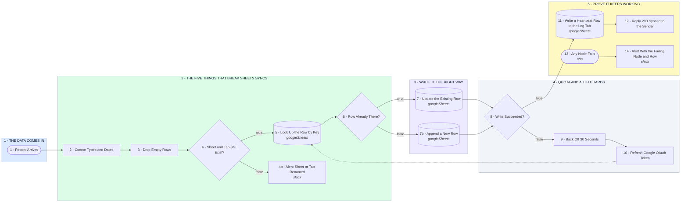

# Your Google Sheets Sync, Fixed and Bulletproofed

- **1 - THE DATA COMES IN** - Whatever feeds the sheet lands here, one record at a time, so every run can be replayed against the exact payload that broke it.
- **2 - THE FIVE THINGS THAT BREAK SHEETS SYNCS** - Wrong types, empty rows, a renamed tab, a moved header, and appending when it should update. Each one gets its own guard before a single cell is written.
- **3 - WRITE IT THE RIGHT WAY** - Matched on a key column, so the same record updates its row instead of quietly stacking duplicates at the bottom of the sheet.
- **4 - QUOTA AND AUTH GUARDS** - Google throttles bursts and OAuth tokens expire. A failed write backs off, refreshes the credential, and retries instead of dying silently.
- **5 - PROVE IT KEEPS WORKING** - A heartbeat row on a log tab shows the sync is alive, and any node that fails names itself and the row it was on.
