# Your Monday.com to PandaDoc Contract Engine

```mermaid
flowchart LR
    subgraph sec_intake["1 - CONTRACT REQUEST COMES IN FROM MONDAY"]
        direction TB
        hook(["1 - Monday.com Item Moved to Ready for Contract"])
        item["2 - Monday.com: Fetch the Item and Column Values"]
        asset["3 - Monday.com: Download the Contract PDF"]
    end
    subgraph sec_read["2 - PULL THE FIELDS OUT OF THE PDF"]
        direction TB
        text["4 - Extract Text From PDF<br/><i>extractFile</i>"]
        hastext{"5 - Text Found in the PDF?"}
        ocr["5b - OCR the Scanned Pages Instead"]
        llm{{"6 - Extract Contract Fields to JSON Schema"}}
        model{{"GPT-4o<br/><i>openai</i>"}}
        schema{{"Schema: Party, Address, Value, Term, Start Date"}}
    end
    subgraph sec_check["3 - CHECK EVERYTHING BEFORE ANYTHING IS SENT"]
        direction TB
        valid{"7 - Required Fields Present and Amounts Parse?"}
        hold["7b - Hold the Item and Ask a Human to Confirm<br/><i>slack</i>"]
    end
    subgraph sec_build["4 - BUILD AND SEND THE PANDADOC CONTRACT"]
        direction TB
        create["8 - PandaDoc: Create Document From Template"]
        wait["9 - Wait 20 Seconds for the Draft to Build"]
        ready{"10 - Is the Document in Draft Status Yet?"}
        send["11 - PandaDoc: Send For Signature"]
        update["12 - Monday.com: Write Back the Link and Status"]
    end
    subgraph sec_fail["5 - WHEN SOMETHING BREAKS, EVERYONE KNOWS"]
        direction TB
        err(["13 - Any Step Fails, Anywhere in the Run<br/><i>n8n</i>"])
        alert["14 - Alert the Team With the Failed Run Link<br/><i>slack</i>"]
        failstatus["15 - Monday.com: Flag the Item as Contract Failed"]
    end
    hook --> item
    item --> asset
    asset --> text
    text --> hastext
    hastext -->|true| llm
    hastext -->|false| ocr
    ocr --> llm
    llm --> valid
    valid -->|true| create
    valid -->|false| hold
    create --> wait
    wait --> ready
    ready -->|true| send
    ready -.->|false| wait
    send --> update
    err --> alert
    alert --> failstatus
    model -.- llm
    schema -.- llm
    style sec_intake fill:#dbeafe,stroke:#94a3b8,color:#0f172a
    style sec_read fill:#dcfce7,stroke:#94a3b8,color:#0f172a
    style sec_check fill:#ede9fe,stroke:#94a3b8,color:#0f172a
    style sec_build fill:#f1f5f9,stroke:#94a3b8,color:#0f172a
    style sec_fail fill:#fef9c3,stroke:#94a3b8,color:#0f172a
```

- **1 - CONTRACT REQUEST COMES IN FROM MONDAY** - A column change on the board starts the run. We pull the item, its column values, and the source PDF straight from Monday.
- **2 - PULL THE FIELDS OUT OF THE PDF** - Text first, then one extraction step that returns a fixed JSON schema. Scanned PDFs get routed to OCR instead of failing.
- **3 - CHECK EVERYTHING BEFORE ANYTHING IS SENT** - Required fields present, amounts parse as numbers, dates are real dates. Anything short of that stops here and a person looks at it.
- **4 - BUILD AND SEND THE PANDADOC CONTRACT** - PandaDoc builds the document from your template asynchronously, so we wait for draft status before sending it for signature.
- **5 - WHEN SOMETHING BREAKS, EVERYONE KNOWS** - Any node failing anywhere in the run posts to Slack and writes the failure back onto the Monday item. Nothing goes quiet.
