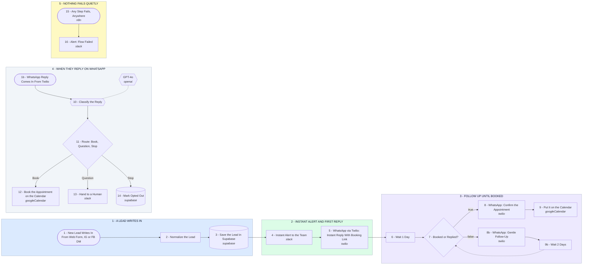

# Your Lead Response and WhatsApp Follow-Up System

- **1 - A LEAD WRITES IN** - Web form, Instagram DM or Facebook DM all land on one webhook, get cleaned into the same shape, and are saved in Supabase before anything else runs.
- **2 - INSTANT ALERT AND FIRST REPLY** - The team hears about the lead in Slack, and the lead gets a WhatsApp reply with a booking link, both within seconds of writing in.
- **3 - FOLLOW UP UNTIL BOOKED** - One day later it checks Supabase. Booked or replied means confirm and put it on the calendar. Silence means a gentle nudge, wait two days, check again.
- **4 - WHEN THEY REPLY ON WHATSAPP** - Twilio posts the inbound message back in. The model reads it and routes it: book the time, hand a real question to a human, or stop messaging them for good.
- **5 - NOTHING FAILS QUIETLY** - If any step in the flow errors, Slack gets the lead, the step and a link to the failed run, so a silent break never costs a booking.
