# Your Shopify/WooCommerce Chatbot and Automation Tasks in n8n

```mermaid
flowchart LR
    subgraph sec_chatbot["1 - SHOPIFY/WOOCOMMERCE CHATBOT: ORDERS AND PRODUCT QUESTIONS"]
        direction TB
        chat(["1 - Shopper Asks a Question in Your Store Chat"])
        sort{{"2 - Claude Sorts It: Order Status, Product Question or a Person"}}
        sort_model{{"Claude - Sorts Each Chat Message<br/><i>anthropic</i>"}}
        sort_memory{{"Memory - Keeps the Thread of This Chat"}}
        sort_parser{{"Parser - Intent, Order Number, Email, Product"}}
        route{"3 - Your Store: Shopify or WooCommerce?"}
        shopify["4a - Shopify: Look Up the Order or the Product"]
        woo["4b - WooCommerce: Look Up the Order or the Product"]
        shape["5 - One Shape for Either Store, Email Must Match"]
        reply{{"6 - Claude Writes the Reply From Your Live Store Data"}}
        reply_model{{"Claude - Writes the Shopper Reply<br/><i>anthropic</i>"}}
        respond["7 - Send the Reply Back to the Shopper"]
    end
    subgraph sec_automation["2 - AUTOMATION TASK: LATE ORDERS FLAGGED TO YOU"]
        direction TB
        late{"8 - Order Still Unshipped Past Your Shipping Promise?"}
        flag["8b - Gmail: Flag the Late Order Before They Ask Again<br/><i>gmail</i>"]
    end
    subgraph sec_improve["3 - BUILDING AND IMPROVING WORKFLOWS: EVERY CHAT LOGGED"]
        direction TB
        log[("9 - Google Sheets: Log Every Chat, Answer and Outcome<br/><i>googleSheets</i>")]
    end
    subgraph sec_connect["4 - CONNECTING SYSTEMS: YOUR INBOX TAKES OVER"]
        direction TB
        person{"10 - Shopper Needs a Person?"}
        handoff["11 - Gmail: Hand the Chat to Your Support Inbox<br/><i>gmail</i>"]
    end
    subgraph sec_support["5 - SUPPORTING ONGOING AUTOMATION NEEDS: NOTHING FAILS QUIETLY"]
        direction TB
        err(["12 - Any Step Fails, Anywhere<br/><i>n8n</i>"])
        alert["13 - Gmail: Send You the Failed Step and a Run Link<br/><i>gmail</i>"]
    end
    chat --> sort
    sort --> route
    route -->|Shopify| shopify
    route -->|WooCommerce| woo
    route -->|No Lookup Needed| shape
    shopify --> shape
    woo --> shape
    shape --> reply
    reply --> respond
    respond --> late
    late -->|true| flag
    late -->|false| log
    flag --> log
    log --> person
    person -->|true| handoff
    err --> alert
    sort_model -.- sort
    sort_memory -.- sort
    sort_parser -.- sort
    reply_model -.- reply
    style sec_chatbot fill:#dbeafe,stroke:#94a3b8,color:#0f172a
    style sec_automation fill:#dcfce7,stroke:#94a3b8,color:#0f172a
    style sec_improve fill:#ede9fe,stroke:#94a3b8,color:#0f172a
    style sec_connect fill:#f1f5f9,stroke:#94a3b8,color:#0f172a
    style sec_support fill:#fef9c3,stroke:#94a3b8,color:#0f172a
```

- **1 - SHOPIFY/WOOCOMMERCE CHATBOT: ORDERS AND PRODUCT QUESTIONS** - Your part 1, the Shopify/WooCommerce chatbot. One setting picks your platform, and order status and product answers come from your live store, never from Claude's memory.
- **2 - AUTOMATION TASK: LATE ORDERS FLAGGED TO YOU** - Your part 2, automation tasks, starting with this one. When a shopper asks about an order still unshipped past your shipping promise, you get an email before they ask twice.
- **3 - BUILDING AND IMPROVING WORKFLOWS: EVERY CHAT LOGGED** - Your part 3, building and improving workflows. Every chat lands in a Google Sheet with the question, the answer and whether a person was needed, so each improvement comes from real chats.
- **4 - CONNECTING SYSTEMS: YOUR INBOX TAKES OVER** - Your part 4, connecting systems. Refunds, cancellations and anything the bot should not guess go to your inbox with the chat and the order, and your reply goes straight to the shopper.
- **5 - SUPPORTING ONGOING AUTOMATION NEEDS: NOTHING FAILS QUIETLY** - Your part 5, supporting ongoing automation needs. If any step fails, say a store key expires, you get the failed step and a link to the run.
