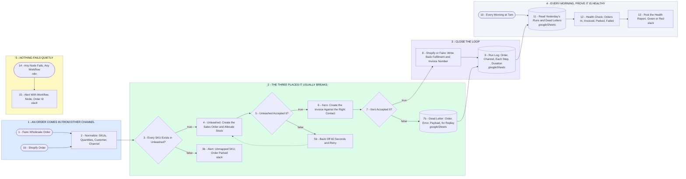

# Your Order to Books Pipeline, Watched and Self-Healing

- **1 - AN ORDER COMES IN FROM EITHER CHANNEL** - Faire wholesale and Shopify DTC land on separate hooks and get flattened into one shape, so every downstream step reads the same fields no matter which channel sent it.
- **2 - THE THREE PLACES IT USUALLY BREAKS** - An unmapped SKU, an Unleashed call that times out or hits a rate limit, and a Xero call on an expired token. Each one gets a gate, and each gate has somewhere safe to put the order instead of dropping it.
- **3 - CLOSE THE LOOP** - The channel gets the fulfilment and invoice number written back, and every run leaves a row behind with timings, so a slow step is visible before it becomes a broken one.
- **4 - EVERY MORNING, PROVE IT IS HEALTHY** - A 7am pass over yesterday's log and dead letters, counted and posted. Green means the numbers reconcile. Red names the orders that need a human before anyone has to ask.
- **5 - NOTHING FAILS QUIETLY** - One error trigger covers every workflow in the instance, so a breakdown announces itself with the workflow, the node and the order id instead of being found days later in a stock count.
