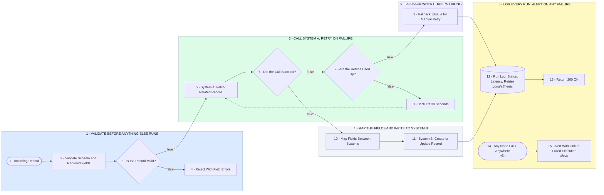

# n8n Hardening: Validate, Retry, Fallback, Log, Alert

- **1 - VALIDATE BEFORE ANYTHING ELSE RUNS** - A bad record is rejected here with the exact field that is wrong, instead of blowing up three API calls later.
- **2 - CALL SYSTEM A, RETRY ON FAILURE** - A failed call waits and tries again rather than killing the run. The retry count is a setting, not a guess.
- **3 - FALLBACK WHEN IT KEEPS FAILING** - Once retries are used up the record is queued for manual retry. Nothing is ever dropped on the floor.
- **4 - MAP THE FIELDS AND WRITE TO SYSTEM B** - One place where field names are translated between the two systems, so a change is a one line edit.
- **5 - LOG EVERY RUN, ALERT ON ANY FAILURE** - Every run leaves a row you can read. Anything that still breaks pings you with a link to the run.
