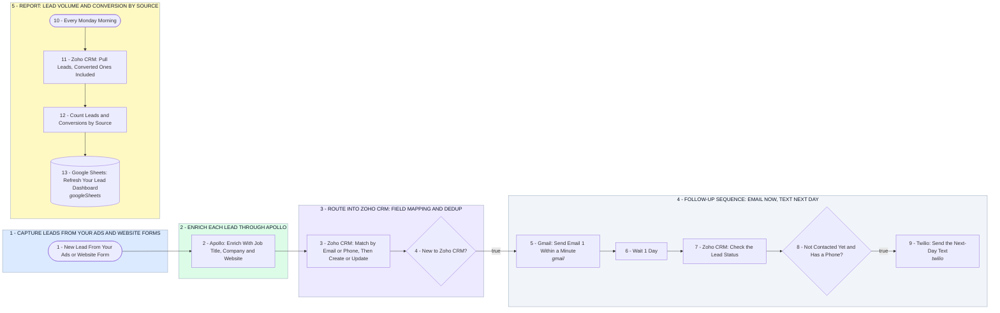

# Your Leads Into Zoho CRM: Enriched, Deduped, Followed Up, Reported

- **1 - CAPTURE LEADS FROM YOUR ADS AND WEBSITE FORMS** - Your website and ad landing-page forms post every lead to one webhook, carrying the UTM tag your Google and Facebook ads add. That tag becomes the lead's source in Zoho. A form that drops the tag files the lead as Website, and your by-source report goes flat.
- **2 - ENRICH EACH LEAD THROUGH APOLLO** - Apollo looks the lead up by work email and adds job title, company, website and location. No match, and the lead carries on without them.
- **3 - ROUTE INTO ZOHO CRM: FIELD MAPPING AND DEDUP** - Every field maps to your Zoho CRM lead layout, and Zoho checks email, then phone, before it writes. New leads are created; returning ones are updated and skip the follow-up.
- **4 - FOLLOW-UP SEQUENCE: EMAIL NOW, TEXT NEXT DAY** - Email 1 goes from your Gmail within a minute, BCC'd to Zoho so it shows on the lead. The next day a text goes out, only if Zoho still shows them not contacted.
- **5 - REPORT: LEAD VOLUME AND CONVERSION BY SOURCE** - Every Monday your Lead Dashboard tab refreshes from Zoho: leads, converted leads and conversion rate per source for the last 30 days.
