# Otter to Docketwise Case Notes System - Meetings and Calls

```mermaid
flowchart LR
    subgraph sec_meetings["1 - IN PERSON MEETINGS RECORDED IN OTTER"]
        direction TB
        otter(["1 - Otter AI: Meeting Transcript Ready"])
        m365["2 - Microsoft 365: Find the Calendar Appointment for This Meeting"]
        pull["3 - Pull Client Name and Case Number From the Appointment"]
        fromcal{"4 - Case Identified From the Calendar?"}
        extract{{"5 - Claude: Extract Client and Case References From the Transcript"}}
        extractmodel{{"Claude<br/><i>anthropic</i>"}}
    end
    subgraph sec_calls["2 - RINGCENTRAL PHONE CALLS"]
        direction TB
        rc(["6 - RingCentral: Call Recording Available"])
        rcfetch["7 - RingCentral: Fetch the Recording and Caller ID"]
        rcphone["8 - Docketwise: Match Contact by Phone Number"]
    end
    subgraph sec_match["3 - MATCH IT TO THE RIGHT MATTER"]
        direction TB
        dwsearch["9 - Docketwise: Search Matter by Client or Case Number"]
        gate{"10 - Exactly One Matter Matched?"}
        confirm["11 - Email Staff to Confirm Which Matter This Belongs To<br/><i>outlook</i>"]
    end
    subgraph sec_note["4 - WRITE THE CASE NOTE"]
        direction TB
        summarize{{"12 - Claude: Summarize Into a Case Note With Decisions, Deadlines and Follow Ups"}}
        notemodel{{"Claude<br/><i>anthropic</i>"}}
        addnote["13 - Docketwise: Add the Note to the Matter"]
    end
    subgraph sec_audit["5 - AUDIT LOG AND FAILURE ALERTS"]
        direction TB
        audit[("14 - Audit Log: Source, Matter and Link to the Note<br/><i>googleSheets</i>")]
        err(["15 - Something Failed Anywhere in the Flow<br/><i>n8n</i>"])
        alert["16 - Email the Office With the Transcript That Did Not File<br/><i>outlook</i>"]
    end
    otter --> m365
    m365 --> pull
    pull --> fromcal
    fromcal -->|true| dwsearch
    fromcal -->|false| extract
    extract --> dwsearch
    rc --> rcfetch
    rcfetch --> rcphone
    rcphone --> gate
    dwsearch --> gate
    gate -->|true| summarize
    gate -->|false| confirm
    summarize --> addnote
    addnote --> audit
    err --> alert
    extractmodel -.- extract
    notemodel -.- summarize
    style sec_meetings fill:#dbeafe,stroke:#94a3b8,color:#0f172a
    style sec_calls fill:#dcfce7,stroke:#94a3b8,color:#0f172a
    style sec_match fill:#ede9fe,stroke:#94a3b8,color:#0f172a
    style sec_note fill:#f1f5f9,stroke:#94a3b8,color:#0f172a
    style sec_audit fill:#fef9c3,stroke:#94a3b8,color:#0f172a
```

- **1 - IN PERSON MEETINGS RECORDED IN OTTER** - Otter finishes a client meeting and we go straight to the Microsoft 365 appointment it belongs to. If the appointment does not name the case, Claude reads the transcript for it.
- **2 - RINGCENTRAL PHONE CALLS** - A recorded call arrives with its caller ID. The phone number is looked up against Docketwise contacts, then it joins the same matching gate the meetings use.
- **3 - MATCH IT TO THE RIGHT MATTER** - One matter, or nobody guesses. Anything ambiguous goes to a person by email before a single word is written to a file.
- **4 - WRITE THE CASE NOTE** - Claude turns the transcript into a case note a paralegal would write: decisions, deadlines, follow-ups. It is posted to the matter in Docketwise.
- **5 - AUDIT LOG AND FAILURE ALERTS** - Every note filed is logged with its source and matter. Anything that errors emails the office instead of disappearing quietly.
