# Your Personal Injury Cases: First Call to Settlement in 3 Languages

```mermaid
flowchart LR
    subgraph sec_reception["1 - AI RECEPTIONIST AND FRONT DESK"]
        direction TB
        answer["1 - AI Receptionist Answers Every Call 24/7 in English, Spanish or Haitian Creole"]
        whocalls["2 - Each Caller Routed to the Right Person, Consults Booked, Reminders by Text and Email"]
    end
    subgraph sec_intake["2 - CLIENT INTAKE AND NEW CASE ONBOARDING"]
        direction TB
        interview["3 - AI Intake in Their Language: Accident, Date, Place, Injuries, Treatment, Insurance"]
        sign["4 - Conflict Check, Attorney Review, Agreement Sent to Sign, Unfinished Intakes Chased"]
    end
    subgraph sec_records["3 - MEDICAL RECORDS AND MEDICAL BILLING"]
        direction TB
        request["5 - Records and Bills Requested From Every Provider, Followed Up Until They Arrive"]
        log["6 - Every Visit, Diagnosis and Bill Logged With the Page It Came From"]
        gaps["7 - Gaps in Treatment or Missing Bills Flagged to the Case Manager"]
    end
    subgraph sec_demand["4 - SETTLEMENT BROCHURE AND DEMAND PACKAGE"]
        direction TB
        draft["8 - Brochure and Demand Letter Drafted From Your Templates, Each Line Tied to a Record"]
        approve{"9 - Attorney Approves Before Anything Leaves the Firm?"}
        edits["9b - Not Yet: The Attorney's Edits Go Back Into the Draft"]
        export["10 - Word and PDF Package With the Exhibit Index Built In"]
    end
    subgraph sec_casemgmt["5 - CASE MANAGEMENT AND CLIENT COMMUNICATION"]
        direction TB
        casefile["11 - Your Case System Updated Once, Stalled Cases Flagged on the Dashboard"]
        updates["12 - Client Updates in Their Language From Approved Wording, Legal Questions Go to Staff"]
    end
    answer --> whocalls
    whocalls --> interview
    interview --> sign
    sign --> request
    request --> log
    log --> gaps
    gaps --> draft
    draft --> approve
    approve -->|Yes, approved| export
    approve -->|Not yet| edits
    edits -.->|Back to the draft| draft
    export --> casefile
    casefile --> updates
    style sec_reception fill:#dbeafe,stroke:#94a3b8,color:#0f172a
    style sec_intake fill:#dcfce7,stroke:#94a3b8,color:#0f172a
    style sec_records fill:#ede9fe,stroke:#94a3b8,color:#0f172a
    style sec_demand fill:#f1f5f9,stroke:#94a3b8,color:#0f172a
    style sec_casemgmt fill:#fef9c3,stroke:#94a3b8,color:#0f172a
```

- **1 - AI RECEPTIONIST AND FRONT DESK** - Every call is answered 24/7 in English, Spanish or Haitian Creole, several at once. Haitian Creole voice gets tested on real-style calls with a Creole speaker you trust before any line goes live.
- **2 - CLIENT INTAKE AND NEW CASE ONBOARDING** - The intake runs by phone, website, text or email in the caller's language. Nothing becomes a case until your conflict check and an attorney have cleared it.
- **3 - MEDICAL RECORDS AND MEDICAL BILLING** - Records and bills are requested with your approved templates and authorizations, then chased until they arrive. Every visit, diagnosis and bill is logged with the page it came from.
- **4 - SETTLEMENT BROCHURE AND DEMAND PACKAGE** - The draft is built only from what is in the file, so nothing is invented. An attorney approves it before anything leaves the firm.
- **5 - CASE MANAGEMENT AND CLIENT COMMUNICATION** - Your parts 5 and 6: one case file in your case management system drives staff tasks and client updates. Staff verify every legally significant deadline.
