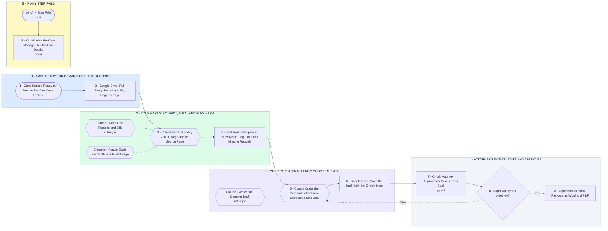

# Your Demand Package Agent: Traceable Draft, Attorney Approves

- **1 - CASE READY FOR DEMAND: PULL THE RECORDS** - Your part 4 starts here: collect the case information automatically. The case's medical records and bills come from its Google Drive folder.
- **2 - YOUR PART 3: EXTRACT, TOTAL AND FLAG GAPS** - Every visit, diagnosis, procedure, provider and charge, each traceable to its document and page. Expenses by provider, and missing records or gaps flagged before a draft exists.
- **3 - YOUR PART 4: DRAFT FROM YOUR TEMPLATE** - The demand letter is drafted from your firm-approved template using only extracted facts, with an organized exhibit index. Nothing is invented.
- **4 - ATTORNEY REVIEWS, EDITS AND APPROVES** - Nothing leaves without attorney approval. Edits go back into the draft; approved packages export to Word and PDF.
- **5 - IF ANY STEP FAILS** - The case manager gets the case number and the failed step, never medical details in the email.
