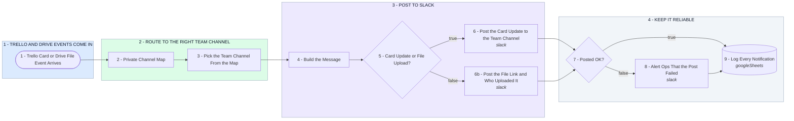

# Your Slack Team Hub - Trello and Drive Wired In

- **1 - TRELLO AND DRIVE EVENTS COME IN** - Two ways in. A Trello card is created or moved to a new list, or a file lands in a watched Drive folder. Make allows one trigger per scenario, so this ships as two scenarios that share everything downstream.
- **2 - ROUTE TO THE RIGHT TEAM CHANNEL** - One table holds team to channel. The board or list name on a Trello card, or the folder name on a Drive file, picks the arm. Anything unrecognised falls to the default arm so nothing is lost.
- **3 - POST TO SLACK** - The message is built once, then posted into the private channel for that team. Card updates and file uploads read differently, so each gets its own wording and its own link back.
- **4 - KEEP IT RELIABLE** - Every post is checked. A refused post alerts ops instead of vanishing, and every notification lands in an audit sheet so you can prove what fired and when.
