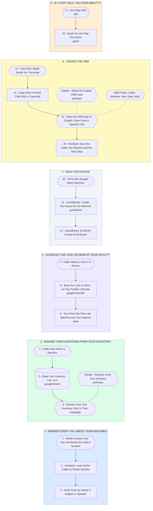

# Your Virtual Receptionist: Every Call, Demo, Invoice and CRM Update

- **1 - ANSWER EVERY CALL ABOUT YOUR MACHINES** - Usually 2-7 calls a day means one every 1 to 4 hours, so a full-time seat mostly waits by the phone. Retell answers every call on the first ring, after hours too, and greets returning callers by name in English or Spanish.
- **2 - ANSWER THEIR QUESTIONS FROM YOUR INVENTORY** - Every answer about your excavators, skid steers and forklifts comes from your inventory list, read live on each question. A machine or a detail that is not on the list gets a callback from you, never a guess.
- **3 - SCHEDULE THE LOOK OR DEMO AT YOUR FACILITY** - The point of every call: get them to your facility to take a look or see a demo in person. It books the time on your calendar and texts them the machine, the time and your address in their language.
- **4 - SEND THE INVOICE** - After a sale you fill a short form from your phone and QuickBooks emails the invoice from your company. Nothing is invoiced until you say who bought which machine and for how much.
- **5 - UPDATE THE CRM** - After every call your CRM gets the caller, the machine they asked about and the next step, written in English even when the call was in Spanish. It is keyed on the caller's phone, so a repeat caller never becomes a duplicate.
- **6 - IF A STEP FAILS, YOU HEAR ABOUT IT** - One alert covers every step: you get the step that broke and a link to the run, so no caller falls through.
