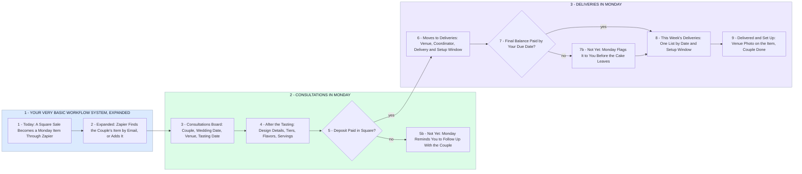

# Square, Zapier and Monday: Wedding Cake Consultations and Deliveries

- **1 - YOUR VERY BASIC WORKFLOW SYSTEM, EXPANDED** - Step 1 is my read of your Square, Zapier and Monday flow today, to confirm on our call. Expanded, every payment lands on the couple's one item, matched by the email on their Square invoice.
- **2 - CONSULTATIONS IN MONDAY** - Each couple from enquiry to tasting to design details on one board. The deposit landing in Square is what books them.
- **3 - DELIVERIES IN MONDAY** - Booked cakes move to Deliveries with the venue, the coordinator and your delivery and setup window. Monday checks the final balance against your due date.
