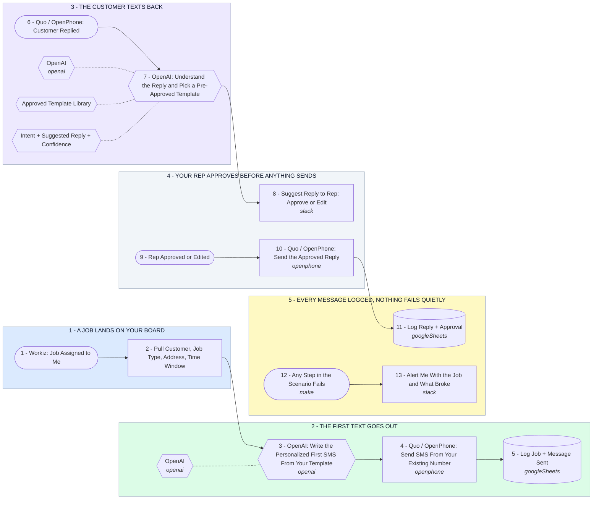

# Workiz Job to SMS Follow-Up System - AI Replies, Human Approval

- **1 - A JOB LANDS ON YOUR BOARD** - The moment Workiz assigns the job to you, this fires. Nobody has to remember to text anyone.
- **2 - THE FIRST TEXT GOES OUT** - Written from your own template, filled with this customer's real job details, sent from the Quo number they already know.
- **3 - THE CUSTOMER TEXTS BACK** - AI reads the reply and picks from your pre-approved templates. It never writes a message from scratch.
- **4 - YOUR REP APPROVES BEFORE ANYTHING SENDS** - The suggestion goes to a person first. Shown here in Slack, but this can just as easily be a Quo internal thread or a text to the rep.
- **5 - EVERY MESSAGE LOGGED, NOTHING FAILS QUIETLY** - One row per conversation, plus an alert the moment a step breaks so a customer is never left on read.
