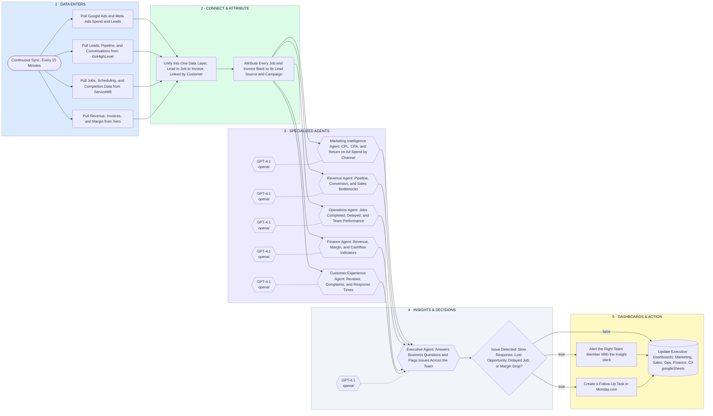

# AI Operating System — Data In → Specialized Agents → Insights → Dashboards & Action

- **1 · DATA ENTERS** — Every business system feeds in on a continuous sync, marketing spend, CRM, jobs, and financials, so the AI layer sees the whole business, not one slice.
- **2 · CONNECT & ATTRIBUTE** — Everything lands in one data layer linked by customer, so a lead can be traced to its job and its invoice, that's what makes cost per lead and profitability answerable.
- **3 · SPECIALIZED AGENTS** — Not one chatbot, a team. Each agent owns one domain and reads only the data it needs, so the answers stay sharp instead of generic.
- **4 · INSIGHTS & DECISIONS** — An executive agent sits over the team, answers questions like how many roofing leads this month, and flags issues before someone has to notice them.
- **5 · DASHBOARDS & ACTION** — Insights become dashboards for management and alerts and tasks for the team, that's the part that actually saves staff time.
