# Claude Cowork and Your First Skills: Set Up Once, Then a New Skill a Week

```mermaid
flowchart LR
    subgraph sec_cowork["1 - SET UP CLAUDE COWORK"]
        direction TB
        account["1 - Set Up Your Claude Account on a Plan That Includes Cowork"]
        install["2 - Install Claude on Your Computer and Open Cowork"]
        folder["3 - Give Claude One Folder for Your Notes, Files and Drafts"]
        connect["4 - Connect the Tools You Already Use: Email, Calendar and Files"]
        about["5 - Tell Claude Once How You Write and How You Sign Off"]
    end
    subgraph sec_skills["2 - YOUR FIRST SKILLS"]
        direction TB
        inquiries["6 - Skill 1: Draft a Reply to Each New Inquiry"]
        docs["7 - Skill 2: Turn Your Rough Notes Into a Polished Document"]
        inbox["8 - Skill 3: Write a Weekly Summary of Your Inbox"]
        posts["9 - Skill 4: Turn Your Notes Into a Social Post or Newsletter"]
        test["10 - Test Each Skill on a Real Example From Your Week"]
        drafts["11 - Nothing Sends on Its Own: Every Draft Waits for Your OK"]
    end
    subgraph sec_ongoing["3 - ADD A SKILL A WEEK, ONGOING"]
        direction TB
        weekly["12 - Each Week, the Task That Took Your Time Becomes a New Skill"]
    end
    account --> install
    install --> folder
    folder --> connect
    connect --> about
    about --> inquiries
    inquiries --> docs
    docs --> inbox
    inbox --> posts
    posts --> test
    test --> drafts
    drafts --> weekly
    style sec_cowork fill:#dbeafe,stroke:#94a3b8,color:#0f172a
    style sec_skills fill:#dcfce7,stroke:#94a3b8,color:#0f172a
    style sec_ongoing fill:#ede9fe,stroke:#94a3b8,color:#0f172a
```

- **1 - SET UP CLAUDE COWORK** - Claude on your own computer, working in one folder you choose, with your email, calendar and files connected. You can start using it the same day.
- **2 - YOUR FIRST SKILLS** - A skill is a set of saved instructions Claude reuses, so you explain a task once and get the same result every time. We start with four everyday jobs and test each one on a real example.
- **3 - ADD A SKILL A WEEK, ONGOING** - You said ongoing, so the list keeps growing. Each week you tell me the task that took your time and it becomes the next skill.
