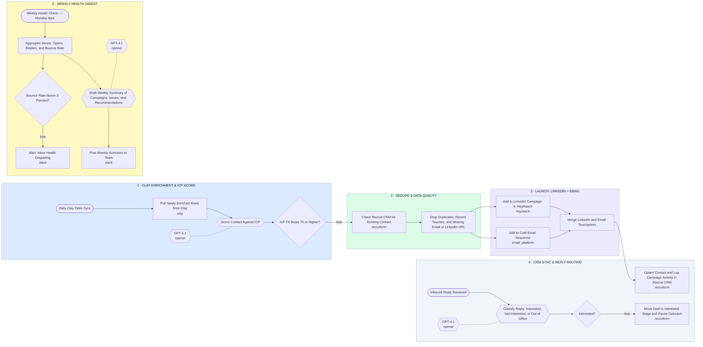

# Clay Enrichment → LinkedIn + Email Launch → Recruit CRM Sync → Weekly Health Digest

- **1 · CLAY ENRICHMENT & ICP SCORE** — Pulls newly enriched rows off the Clay table and scores each contact against the ICP before anything else runs.
- **2 · DEDUPE & DATA QUALITY** — Checks Recruit CRM for an existing contact and drops duplicates, recently-touched records, and rows missing an email or LinkedIn URL.
- **3 · LAUNCH: LINKEDIN + EMAIL** — Adds the surviving contacts to the LinkedIn campaign and the cold email sequence in parallel.
- **4 · CRM SYNC & REPLY ROUTING** — Logs every touchpoint back to Recruit CRM and routes inbound replies to pause outreach and move the deal stage.
- **5 · WEEKLY HEALTH DIGEST** — Rolls up sends, opens, replies and bounce rate every Monday and flags deliverability before it becomes a problem.
