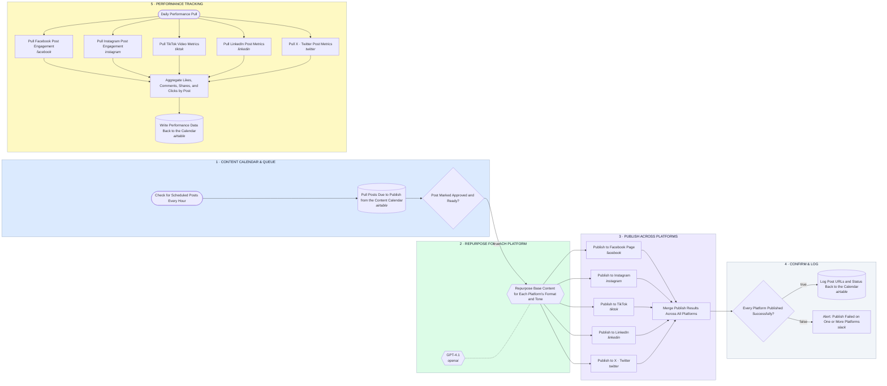

# Content Calendar → AI Repurpose → 5-Platform Publish → Performance Tracking

- **1 · CONTENT CALENDAR & QUEUE** — Checks the calendar every hour for posts due to go out, and only touches ones marked approved.
- **2 · REPURPOSE FOR EACH PLATFORM** — One base piece of content gets reshaped into each platform's own format and tone before anything publishes.
- **3 · PUBLISH ACROSS PLATFORMS** — Fans out to all five platforms in parallel so one slow API doesn't hold up the others.
- **4 · CONFIRM & LOG** — Every publish result gets checked before the calendar is updated, so a silent failure never gets logged as a success.
- **5 · PERFORMANCE TRACKING** — Pulls engagement daily from every platform and writes it straight back to the same calendar record.
