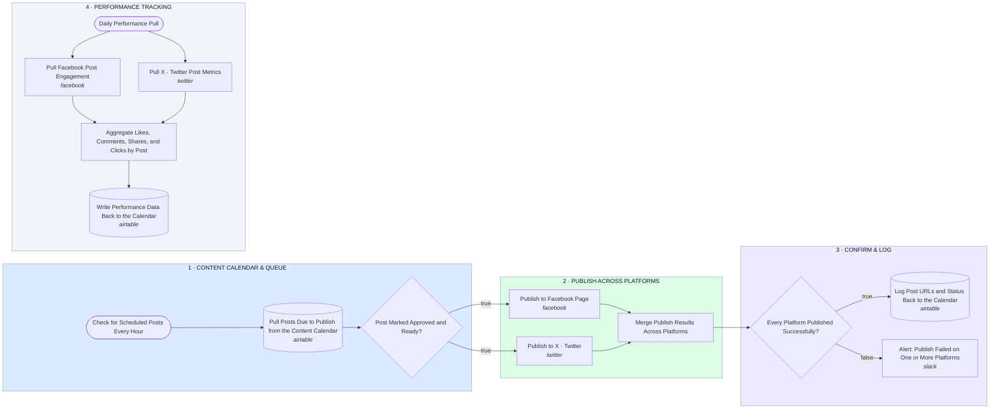

# Content Calendar → Multi-Platform Publish → Performance Tracking

- **1 · CONTENT CALENDAR & QUEUE** — Checks the calendar every hour for posts due to go out, and only touches ones marked approved.
- **2 · PUBLISH ACROSS PLATFORMS** — Fans out to each platform in parallel so one slow API doesn't hold up the others.
- **3 · CONFIRM & LOG** — Every publish result gets checked before the calendar is updated, so a silent failure never gets logged as a success.
- **4 · PERFORMANCE TRACKING** — Pulls engagement daily and writes it straight back to the same calendar record.
