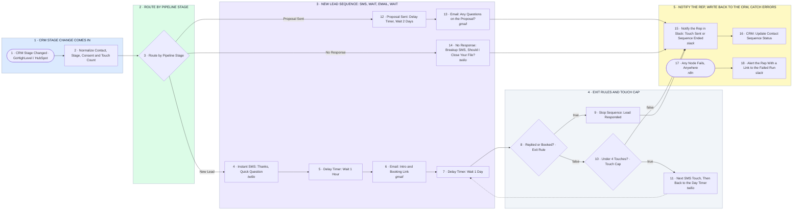

# CRM Stage Trigger to SMS + Email Follow-Up With Exit Rules

- **1 · CRM STAGE CHANGE COMES IN** — GoHighLevel or HubSpot fires a webhook when a contact moves stage. We normalize the contact so every stage below reads the same fields.
- **2 · ROUTE BY PIPELINE STAGE** — One switch, one sequence per stage. Adding a stage later is one more arm, not a rebuild.
- **3 · NEW LEAD SEQUENCE: SMS, WAIT, EMAIL, WAIT** — Instant SMS while the lead is still warm, email an hour later, then a full day before the next check. Every delay timer is visible in its label.
- **4 · EXIT RULES AND TOUCH CAP** — If they replied or booked, the sequence stops. Otherwise one more SMS and back to the day timer, until the touch cap ends it.
- **5 · NOTIFY THE REP, WRITE BACK TO THE CRM, CATCH ERRORS** — The rep sees every touch in Slack and the CRM holds the sequence state. Any failure alerts with a link to the run.
