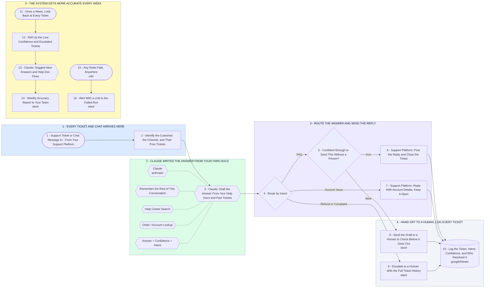

# Customer Support Automation System - Answer, Escalate, Learn

- **1 - EVERY TICKET AND CHAT ARRIVES HERE** - One entry point for every channel. Before anything is written we know who is asking and what they asked last time.
- **2 - CLAUDE WRITES THE ANSWER FROM YOUR OWN DOCS** - It answers from your help center and past tickets, not from guesswork. It also returns how confident it is.
- **3 - ROUTE THE ANSWER AND SEND THE REPLY** - Simple questions get answered and closed. Anything about an account gets answered but stays open.
- **4 - HAND OFF TO A HUMAN, LOG EVERY TICKET** - Low confidence, refunds and complaints go to a person with the draft attached. Every ticket lands in the log either way.
- **5 - THE SYSTEM GETS MORE ACCURATE EVERY WEEK** - Once a week Claude reads what it got wrong and tells you which help docs to write next.
