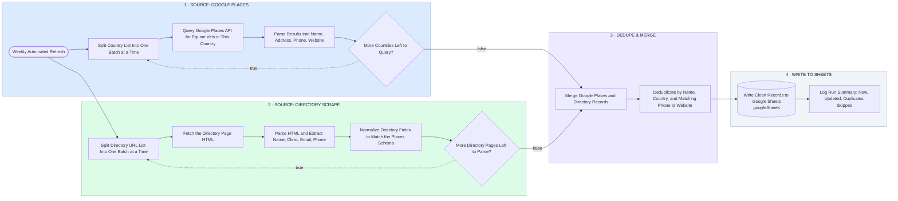

# Equine Vet Database — Google Places + Directory Scrape → Dedupe → Google Sheets

- **1 · SOURCE: GOOGLE PLACES** — Loops through the country list and queries the official Places API for equine vets in each one.
- **2 · SOURCE: DIRECTORY SCRAPE** — Loops through the directory URLs, fetches the HTML, and parses contact data in code, the BeautifulSoup-equivalent step run inside the workflow.
- **3 · DEDUPE & MERGE** — Both sources land in one merge, then get deduplicated by name, country, and matching phone or website.
- **4 · WRITE TO SHEETS** — Clean records write straight to Google Sheets, with a run summary logged for visibility.
