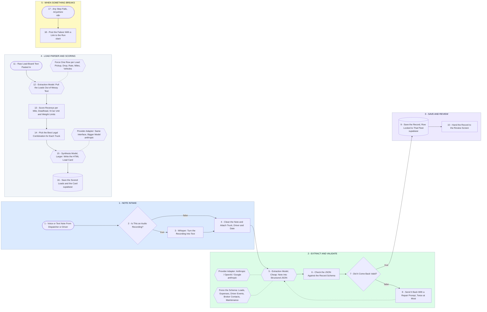

# Fleet Notes to Structured Records Pipeline - Milestone 1 and 3

- **1 - NOTE INTAKE** - A dispatcher or driver sends a voice note or a text note. Audio goes through Whisper first, text skips straight ahead.
- **2 - EXTRACT AND VALIDATE** - The cheap model turns the note into JSON. Nothing is trusted until it passes the schema check.
- **3 - SAVE AND REVIEW** - The clean record lands in Supabase and comes back to the review screen for a human to confirm.
- **4 - LOAD PARSER AND SCORING** - Pasted load-board text becomes scored loads, then the best legal combination for each truck, then a load card.
- **5 - WHEN SOMETHING BREAKS** - Every failure is caught and posted with a link to the exact run. Nothing drops silently.
