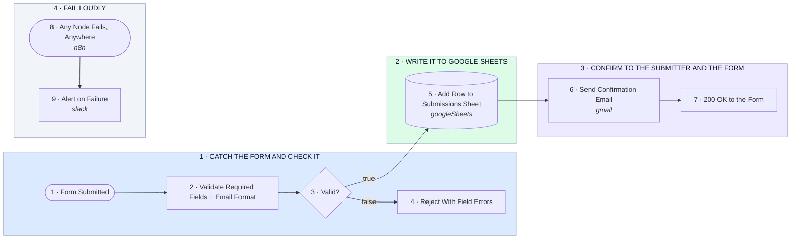

# Form Webhook → Validate → Google Sheets → Confirmation Email

- **1 · CATCH THE FORM AND CHECK IT** — The form posts to one webhook URL. Missing fields or a bad email get rejected right away with a clear reason, so junk never reaches the sheet.
- **2 · WRITE IT TO GOOGLE SHEETS** — One clean row per submission, with a timestamp and a submission id. The same webhook can feed an AI agent later without touching this part.
- **3 · CONFIRM TO THE SUBMITTER AND THE FORM** — A personalized confirmation email goes out, then the form gets a 200 with the submission id.
- **4 · FAIL LOUDLY** — If Sheets or Gmail ever errors, a Slack alert with a link to the failed run. Nothing drops silently.
