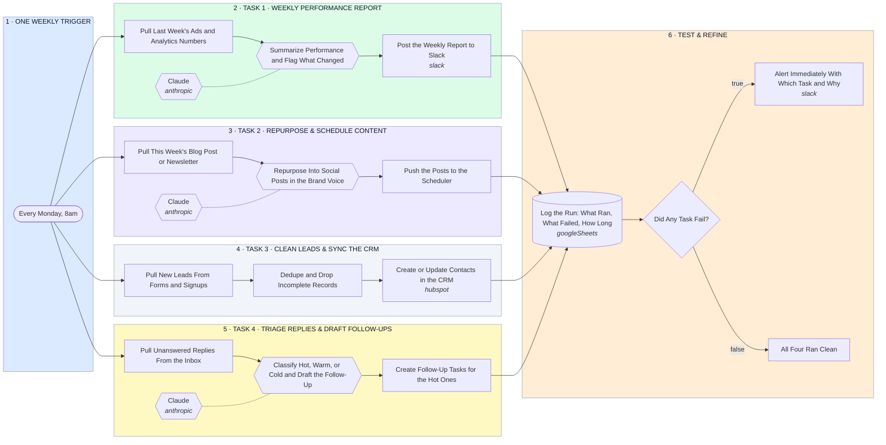

# Four Weekly Marketing Tasks, Automated — Report, Repurpose, Clean Leads, Triage Replies

- **1 · ONE WEEKLY TRIGGER** — One schedule kicks off all four tasks, so nothing depends on someone remembering to start it.
- **2 · TASK 1 · WEEKLY PERFORMANCE REPORT** — Pulls last week's numbers, has AI summarize what actually changed, and posts it before the week starts.
- **3 · TASK 2 · REPURPOSE & SCHEDULE CONTENT** — Turns the week's long-form piece into social posts in the brand voice and pushes them to the scheduler.
- **4 · TASK 3 · CLEAN LEADS & SYNC THE CRM** — New signups get deduped and checked before they touch the CRM, so the list stays clean without a weekly manual pass.
- **5 · TASK 4 · TRIAGE REPLIES & DRAFT FOLLOW-UPS** — Unanswered replies get classified hot, warm, or cold, with a follow-up drafted for each, so nothing sits in the inbox.
- **6 · TEST & REFINE** — Every run logs what ran, what failed, and how long it took, and a failure alerts immediately, that's how the workflows get refined on real data instead of guesswork.
