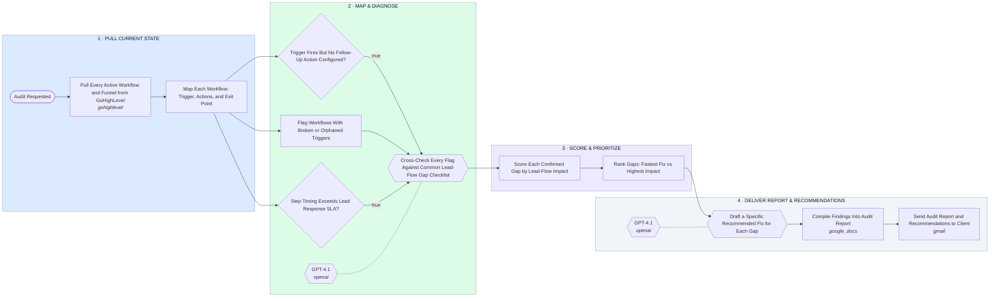

# GoHighLevel Audit — Map Automations, Flag Gaps, Recommend Fixes

- **1 · PULL CURRENT STATE** — Pulls every active workflow and funnel straight from the account instead of relying on a description of what should be running.
- **2 · MAP & DIAGNOSE** — Maps each workflow's trigger, actions, and exit point, then runs it through three checks a lead can silently fall through.
- **3 · SCORE & PRIORITIZE** — Scores every confirmed gap by lead-flow impact so the fix list is ordered by what actually costs leads, not by what's easiest.
- **4 · DELIVER REPORT & RECOMMENDATIONS** — Turns the flagged gaps into specific, named fixes and sends the report rather than a vague punch list.
