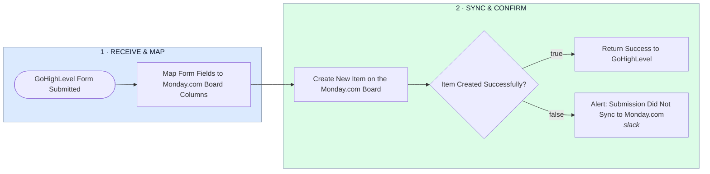

# GoHighLevel Form → Field Mapping → Monday.com Item

- **1 · RECEIVE & MAP** — Catches the form submission the moment it happens and maps it to your board's actual columns.
- **2 · SYNC & CONFIRM** — Creates the item, then checks it actually landed instead of assuming it did.
