# How I Audit a Creator Funnel — Content to Purchase, Metric by Metric

```mermaid
flowchart LR
    subgraph sec_engage["1 · CONTENT → ENGAGEMENT"]
        direction TB
        map_engagement["Map Where Engagement Comes From: Which Content, Which Platform, Which Comments"]
        metric_engage["Check the Metric: Engagement Volume vs How Much Ever Becomes a Lead"]
    end
    subgraph sec_capture["2 · LEAD CAPTURE"]
        direction TB
        check_capture["Check Every Point Where a Comment or Follower Is Asked to Become a Lead"]
        metric_capture["Check the Metric: Engagement-to-Lead Capture Rate"]
    end
    subgraph sec_convert["3 · LANDING PAGE & CHECKOUT"]
        direction TB
        check_checkout["Check the Landing Page and Checkout Flow, Where People Drop Off"]
        metric_checkout["Check the Metric: Landing Page Conversion and Checkout Abandonment Rate"]
    end
    subgraph sec_recover["4 · FOLLOW-UP & RETARGETING"]
        direction TB
        check_recover["Check Every Automation Trigger, Follow-Up Sequence, and Retargeting Audience"]
        metric_recover["Check the Metric: Recovery Rate on Abandoned Checkouts and Cold Leads"]
    end
    subgraph sec_measure["5 · ATTRIBUTION & DASHBOARD"]
        direction TB
        trace_attribution["Trace Attribution End to End: Which Content Actually Produced Purchases"]
        build_dashboard["Build the Dashboard: Comments → Leads → Checkouts → Purchases"]
        recommend["Rank Every Leak by Revenue Lost and Recommend the Fix, Stack Included"]
    end
    map_engagement --> metric_engage
    metric_engage --> check_capture
    check_capture --> metric_capture
    metric_capture --> check_checkout
    check_checkout --> metric_checkout
    metric_checkout --> check_recover
    check_recover --> metric_recover
    metric_recover --> trace_attribution
    trace_attribution --> build_dashboard
    build_dashboard --> recommend
    style sec_engage fill:#dbeafe,stroke:#94a3b8,color:#0f172a
    style sec_capture fill:#dcfce7,stroke:#94a3b8,color:#0f172a
    style sec_convert fill:#ede9fe,stroke:#94a3b8,color:#0f172a
    style sec_recover fill:#f1f5f9,stroke:#94a3b8,color:#0f172a
    style sec_measure fill:#fef9c3,stroke:#94a3b8,color:#0f172a
```

- **1 · CONTENT → ENGAGEMENT** — Before judging anything downstream, I map exactly where the engagement comes from and how much of it ever turns into a lead.
- **2 · LEAD CAPTURE** — Every point where a comment or follower is asked to become a lead gets checked on its own capture rate.
- **3 · LANDING PAGE & CHECKOUT** — Where people actually drop off between clicking and paying, measured, not assumed.
- **4 · FOLLOW-UP & RETARGETING** — Every automation trigger, follow-up sequence, and retargeting audience checked against what it actually recovers.
- **5 · ATTRIBUTION & DASHBOARD** — The whole journey traced end to end, so the dashboard shows comments to purchases and the recommendations are backed by real numbers.
