# How I Audit a Customer Journey — Stage by Stage, Metric by Metric

```mermaid
flowchart LR
    subgraph sec_capture["1 · CAPTURE — HOW JOURNEYS BEGIN"]
        direction TB
        map_entry["Map Every Entry Point: Forms, Ads, Referrals, Events"]
        metric_capture["Check the Metric: Capture Rate and Time to First Touchpoint"]
    end
    subgraph sec_nurture["2 · NURTURE — TOUCHPOINTS & ENGAGEMENT"]
        direction TB
        check_touch["Check Every Touchpoint in the Nurture Sequence and What Triggers It"]
        metric_nurture["Check the Metric: Engagement Rate and Response Rate by Touchpoint"]
    end
    subgraph sec_convert["3 · CONVERSION — WHERE INTENT BECOMES ACTION"]
        direction TB
        check_convert["Check Where and How a Lead Is Asked to Convert"]
        metric_convert["Check the Metric: Conversion Rate at Each Journey Stage"]
    end
    subgraph sec_retain["4 · RETENTION — LIFECYCLE AFTER THE SALE"]
        direction TB
        check_retain["Check What Happens After the Sale: Onboarding, Upsell, Win-Back"]
        metric_retain["Check the Metric: Retention Rate and Repeat Engagement"]
    end
    subgraph sec_fix["5 · FINDINGS & FIX"]
        direction TB
        log_gaps["Log Every Gap Against Its Stage and Its Metric"]
        rank_gaps["Rank Gaps by Which Stage Is Losing the Most Conversion or Retention"]
        fix_top["Fix the Highest-Impact Stage First"]
    end
    map_entry --> metric_capture
    metric_capture --> check_touch
    check_touch --> metric_nurture
    metric_nurture --> check_convert
    check_convert --> metric_convert
    metric_convert --> check_retain
    check_retain --> metric_retain
    metric_retain --> log_gaps
    log_gaps --> rank_gaps
    rank_gaps --> fix_top
    style sec_capture fill:#dbeafe,stroke:#94a3b8,color:#0f172a
    style sec_nurture fill:#dcfce7,stroke:#94a3b8,color:#0f172a
    style sec_convert fill:#ede9fe,stroke:#94a3b8,color:#0f172a
    style sec_retain fill:#f1f5f9,stroke:#94a3b8,color:#0f172a
    style sec_fix fill:#fef9c3,stroke:#94a3b8,color:#0f172a
```

- **1 · CAPTURE — HOW JOURNEYS BEGIN** — Before judging anything downstream, I map every entry point a customer journey can start from.
- **2 · NURTURE — TOUCHPOINTS & ENGAGEMENT** — Every touchpoint in the sequence gets checked against its own engagement number, not assumed to be working.
- **3 · CONVERSION — WHERE INTENT BECOMES ACTION** — Wherever a journey asks for a decision, that step gets measured on its own conversion rate.
- **4 · RETENTION — LIFECYCLE AFTER THE SALE** — The journey doesn't end at the sale, so neither does the audit.
- **5 · FINDINGS & FIX** — Every gap gets tied to its stage and its metric, then fixed in order of what's actually losing the most conversion or retention.
