# How I Audit a GoHighLevel Account — Define, Compare, Prioritize, Recommend

```mermaid
flowchart LR
    subgraph sec_define["1 · DEFINE EXPECTED BEHAVIOR"]
        direction TB
        pull["List Every Active Workflow in the Account"]
        define_io["Define Each Workflow's Input and Expected Output"]
    end
    subgraph sec_compare["2 · COMPARE ACTUAL VS EXPECTED"]
        direction TB
        trace["Trace What Each Workflow Actually Does, Step by Step"]
        compare_io["Compare Actual Output Against Expected Output"]
        measure["Measure Efficiency: Step Count, Delay Time, Drop-Off Points"]
    end
    subgraph sec_log["3 · LOG EVERY GAP"]
        direction TB
        log_gaps["Log Every Gap Found, With Its Root Cause"]
    end
    subgraph sec_recommend["4 · PRIORITIZE & RECOMMEND"]
        direction TB
        prioritize["Sort Every Logged Gap by Lead-Flow Impact"]
        assign_fix["Assign Each Gap a Fix: Quick Fix or Rebuild"]
        compile["Compile Into One Prioritized List"]
        present["Walk the Client Through Findings and Fixes"]
    end
    pull --> define_io
    define_io --> trace
    trace --> compare_io
    compare_io --> measure
    measure --> log_gaps
    log_gaps --> prioritize
    prioritize --> assign_fix
    assign_fix --> compile
    compile --> present
    style sec_define fill:#dbeafe,stroke:#94a3b8,color:#0f172a
    style sec_compare fill:#dcfce7,stroke:#94a3b8,color:#0f172a
    style sec_log fill:#ede9fe,stroke:#94a3b8,color:#0f172a
    style sec_recommend fill:#f1f5f9,stroke:#94a3b8,color:#0f172a
```

- **1 · DEFINE EXPECTED BEHAVIOR** — Before judging anything, I write down what each workflow is supposed to do.
- **2 · COMPARE ACTUAL VS EXPECTED** — I trace what the workflow actually does and measure it against that expectation, across every workflow in the account.
- **3 · LOG EVERY GAP** — Anywhere actual and expected don't match gets logged with its root cause.
- **4 · PRIORITIZE & RECOMMEND** — Gaps get sorted by lead-flow impact and each one gets a specific fix, not a vague note.
