# How I Audit a Real Estate Lead Pipeline — Stage by Stage, Metric by Metric

```mermaid
flowchart LR
    subgraph sec_top["1 · TOP OF FUNNEL — LEAD CAPTURE"]
        direction TB
        map_sources["Map Every Source Leads Come From: Ads, Forms, Calls, Referrals"]
        metric_capture["Check the Metric: Cost Per Lead and Capture Rate by Source"]
    end
    subgraph sec_speed["2 · SPEED TO LEAD — FIRST RESPONSE"]
        direction TB
        check_response["Check How Fast and How a New Lead Gets a First Response"]
        metric_speed["Check the Metric: Minutes to First Contact"]
    end
    subgraph sec_nurture["3 · PIPELINE PROGRESSION — NURTURE"]
        direction TB
        check_pipeline["Check Whether Leads Land in the Right Pipeline and Stage"]
        metric_nurture["Check the Metric: Follow-Up Cadence and Stage Drop-Off Rate"]
    end
    subgraph sec_close["4 · CONVERSION — CLOSE & FOLLOW-UP"]
        direction TB
        check_close["Check What Happens at Appointment Set and at No-Show"]
        metric_close["Check the Metric: Lead-to-Appointment and Appointment-to-Close Rate"]
    end
    subgraph sec_fix["5 · FINDINGS & FIX"]
        direction TB
        log_gaps["Log Every Gap Against Its Stage and Its Metric"]
        rank_gaps["Rank Gaps by Which Stage Is Losing the Most Leads"]
        fix_top["Fix the Highest-Impact Stage First"]
    end
    map_sources --> metric_capture
    metric_capture --> check_response
    check_response --> metric_speed
    metric_speed --> check_pipeline
    check_pipeline --> metric_nurture
    metric_nurture --> check_close
    check_close --> metric_close
    metric_close --> log_gaps
    log_gaps --> rank_gaps
    rank_gaps --> fix_top
    style sec_top fill:#dbeafe,stroke:#94a3b8,color:#0f172a
    style sec_speed fill:#dcfce7,stroke:#94a3b8,color:#0f172a
    style sec_nurture fill:#ede9fe,stroke:#94a3b8,color:#0f172a
    style sec_close fill:#f1f5f9,stroke:#94a3b8,color:#0f172a
    style sec_fix fill:#fef9c3,stroke:#94a3b8,color:#0f172a
```

- **1 · TOP OF FUNNEL — LEAD CAPTURE** — Before judging anything downstream, I map every source a lead can come from and what it costs to get one.
- **2 · SPEED TO LEAD — FIRST RESPONSE** — This is the single stage most real estate pipelines lose leads at, so it gets checked on its own metric.
- **3 · PIPELINE PROGRESSION — NURTURE** — Right pipeline, right stage, right cadence, checked against where leads actually stall.
- **4 · CONVERSION — CLOSE & FOLLOW-UP** — The stage that turns activity into closed deals, measured the same way as every stage before it.
- **5 · FINDINGS & FIX** — Every gap gets tied to its stage and its metric, then fixed in order of what's actually losing the most leads.
