# How I Audit for ROI — Find the Leaks, Size the Cost, Fix What Pays

```mermaid
flowchart LR
    subgraph sec_map["1 · MAP THE REVENUE PATH"]
        direction TB
        list_funnels["List Every Funnel and Automation Currently Spending Money or Time"]
        map_value["Map Where Each Lead Enters and What It Should Be Worth"]
    end
    subgraph sec_leak["2 · FIND WHERE MONEY LEAKS"]
        direction TB
        trace_dropoff["Trace Exactly Where Leads Drop Off or Stall"]
        flag_overspend["Flag Steps Burning Ad Spend or Tool Cost With No Return"]
    end
    subgraph sec_size["3 · SIZE THE COST"]
        direction TB
        quantify["Put a Dollar Number on Every Leak: Lost Leads x Close Rate x Deal Value"]
        rank_roi["Rank Every Leak by Revenue Impact, Highest Cost First"]
    end
    subgraph sec_fix["4 · FIX FOR ROI"]
        direction TB
        fix_top["Fix the Highest-ROI Leak First, Not the Easiest One"]
        adjust_funnel["Adjust the Funnel to Close Where the Money Was Leaking"]
        remeasure["Re-Measure Conversion Rate and Cost Per Lead After the Fix"]
        report_dollars["Report the Dollar Impact, Not Just What Changed"]
    end
    list_funnels --> map_value
    map_value --> trace_dropoff
    trace_dropoff --> flag_overspend
    flag_overspend --> quantify
    quantify --> rank_roi
    rank_roi --> fix_top
    fix_top --> adjust_funnel
    adjust_funnel --> remeasure
    remeasure --> report_dollars
    style sec_map fill:#dbeafe,stroke:#94a3b8,color:#0f172a
    style sec_leak fill:#dcfce7,stroke:#94a3b8,color:#0f172a
    style sec_size fill:#ede9fe,stroke:#94a3b8,color:#0f172a
    style sec_fix fill:#f1f5f9,stroke:#94a3b8,color:#0f172a
```

- **1 · MAP THE REVENUE PATH** — Before touching anything, I map where every lead enters and what it should be worth by the time it converts.
- **2 · FIND WHERE MONEY LEAKS** — Every drop-off, stall, or wasted send is either lost revenue or wasted spend.
- **3 · SIZE THE COST** — Every leak gets a real dollar number, not a general note that something looks off.
- **4 · FIX FOR ROI** — I fix the highest-dollar leak first and prove the fix worked in the numbers, not just in what changed.
