# How I Build an Automation Roadmap — Map, Find Inefficiency, Score ROI, Sequence

```mermaid
flowchart LR
    subgraph sec_map["1 · MAP CURRENT PROCESSES"]
        direction TB
        list_processes["List Every Marketing Workflow Run Manually or Semi-Manually"]
        metric_hours["Check the Metric: Hours Spent per Week on Each Process"]
    end
    subgraph sec_find["2 · FIND THE INEFFICIENCY"]
        direction TB
        find_repeat["Check Where the Same Task Gets Repeated by a Person Instead of a System"]
        metric_error["Check the Metric: Error Rate or Delay Introduced by Manual Handling"]
    end
    subgraph sec_score["3 · SCORE THE OPPORTUNITY"]
        direction TB
        estimate_savings["Estimate Hours Saved and Technical Feasibility for Each Candidate"]
        metric_roi["Check the Metric: Hours Saved per Month vs Setup Effort"]
    end
    subgraph sec_map_out["4 · BUILD THE ROADMAP"]
        direction TB
        rank_opportunities["Rank Every Opportunity by ROI and Ease of Implementation"]
        sequence_roadmap["Sequence Into a Roadmap: Quick Wins First, Bigger Builds After"]
        hand_off["Hand Off the Roadmap With a Recommendation for Each Item"]
    end
    list_processes --> metric_hours
    metric_hours --> find_repeat
    find_repeat --> metric_error
    metric_error --> estimate_savings
    estimate_savings --> metric_roi
    metric_roi --> rank_opportunities
    rank_opportunities --> sequence_roadmap
    sequence_roadmap --> hand_off
    style sec_map fill:#dbeafe,stroke:#94a3b8,color:#0f172a
    style sec_find fill:#dcfce7,stroke:#94a3b8,color:#0f172a
    style sec_score fill:#ede9fe,stroke:#94a3b8,color:#0f172a
    style sec_map_out fill:#f1f5f9,stroke:#94a3b8,color:#0f172a
```

- **1 · MAP CURRENT PROCESSES** — Before recommending anything, I list every marketing workflow that's currently run manually or semi-manually.
- **2 · FIND THE INEFFICIENCY** — Every repeated manual task gets checked against what it actually costs in time and errors.
- **3 · SCORE THE OPPORTUNITY** — Every automation candidate gets a real ROI number, not a gut feeling about what seems worth building.
- **4 · BUILD THE ROADMAP** — Opportunities get sequenced by ROI and ease, quick wins first, so the roadmap is practical, not aspirational.
