# How I Diagnose a Broken AI Email Automation

```mermaid
flowchart LR
    subgraph sec_diagnose["1 · DIAGNOSE"]
        direction TB
        confirm_symptom["Confirm the Exact Symptom: No Email, Bad Content, or Wrong Recipient"]
        check_trigger["Check Whether the Automation Trigger Actually Fired"]
        check_generation["Check the AI Generation Step: Valid Output, Timeout, or Malformed Response"]
        check_send["Check the Send Step: Correct Recipient, Correct Template Slot"]
        isolate_cause["Isolate the Root Cause: Trigger, Generation, or Send"]
    end
    subgraph sec_fix["2 · FIX & CONFIRM"]
        direction TB
        apply_fix["Apply the Fix at the Exact Point of Failure"]
        retest["Re-Run the Automation End to End and Read the Generated Email"]
        confirm_fix["Confirm the Fix Holds Before Handing It Back"]
    end
    confirm_symptom --> check_trigger
    check_trigger --> check_generation
    check_generation --> check_send
    check_send --> isolate_cause
    isolate_cause --> apply_fix
    apply_fix --> retest
    retest --> confirm_fix
    style sec_diagnose fill:#dbeafe,stroke:#94a3b8,color:#0f172a
    style sec_fix fill:#dcfce7,stroke:#94a3b8,color:#0f172a
```

- **1 · DIAGNOSE** — With AI in the loop there's an extra place it can break, the generation step itself, not just the trigger and the send.
- **2 · FIX & CONFIRM** — The fix goes exactly where the diagnosis pointed, then gets proven with a real test run, content included.
