# How I Diagnose a Broken CRM/Email Automation

```mermaid
flowchart LR
    subgraph sec_diagnose["1 · DIAGNOSE"]
        direction TB
        confirm_symptom["Confirm the Exact Symptom: No Email, Wrong Sequence, Stuck Contact, or Bad Condition"]
        check_trigger["Check Whether the Automation Trigger Actually Fired"]
        check_condition["Check Every Condition or Filter on the Failing Step"]
        check_action["Check the Action Itself: Email Send, Stage Move, or Sequence Assignment"]
        isolate_cause["Isolate the Root Cause: Trigger, Condition, or Action"]
    end
    subgraph sec_fix["2 · FIX & CONFIRM"]
        direction TB
        apply_fix["Apply the Fix at the Exact Point of Failure"]
        retest["Re-Run the Automation End to End With a Test Contact"]
        confirm_fix["Confirm the Fix Holds Before Handing It Back"]
    end
    confirm_symptom --> check_trigger
    check_trigger --> check_condition
    check_condition --> check_action
    check_action --> isolate_cause
    isolate_cause --> apply_fix
    apply_fix --> retest
    retest --> confirm_fix
    style sec_diagnose fill:#dbeafe,stroke:#94a3b8,color:#0f172a
    style sec_fix fill:#dcfce7,stroke:#94a3b8,color:#0f172a
```

- **1 · DIAGNOSE** — I isolate the exact point of failure before touching anything, trigger, condition, or action.
- **2 · FIX & CONFIRM** — The fix goes exactly where the diagnosis pointed, then gets proven with a real test run.
