# How I Fine Tune Your Medical Report Classifier, Step by Step

```mermaid
flowchart LR
    subgraph sec_clean["1 - CLEAN THE DATA AND LOCK AN HONEST TEST SET"]
        direction TB
        dedupe["1 - Read the CSV and Drop Exact Duplicate Reports"]
        normalize["2 - Catch Near Duplicates and Normalize the Formatting"]
        suspect{"3 - Do Any Rows Look Mislabeled?"}
        confirm["3a - Send Those Rows Back for You to Confirm"]
        holdout["4 - Hold Out a Balanced Test Set Before Anything Trains"]
    end
    subgraph sec_pick["2 - PICK THE SMALLEST MODEL THAT DOES THE JOB"]
        direction TB
        choose["5 - Choose a Small Classifier or a Small Instruct Model"]
        reason["6 - Decide If Each Answer Needs a Written Reason"]
        format["7 - Convert Every Row Into the Training Format"]
    end
    subgraph sec_before["3 - MEASURE THE BEFORE, DO NOT GUESS IT"]
        direction TB
        zeroshot["8 - Score the Untouched Model on the Held Out Set"]
        baseline["9 - Write Down the Baseline Accuracy per Category"]
    end
    subgraph sec_tune["4 - FINE TUNE, THEN GRADE IT PER CATEGORY"]
        direction TB
        train["10 - Train a LoRA Adapter for a Few Short Epochs"]
        score["11 - Score the Tuned Model on the Same Test Set"]
        matrix["12 - Build the Confusion Matrix and per Class Recall"]
        gate{"13 - Does It Beat the Baseline on Urgent Recall?"}
        rerun["13a - Fix Labels, Weight Urgent Higher, Train Again"]
    end
    subgraph sec_handoff["5 - HAND IT OVER SO YOU CAN RUN IT WITHOUT ME"]
        direction TB
        save["14 - Save the Adapter Files and the Training Code"]
        script["15 - One Command Script to Classify a New Report"]
        readme["16 - Write Up Data, Model, Results, Limits and Cost"]
    end
    dedupe --> normalize
    normalize --> suspect
    suspect -->|true| confirm
    suspect -->|false| holdout
    confirm --> holdout
    holdout --> choose
    choose --> reason
    reason --> format
    format --> zeroshot
    zeroshot --> baseline
    baseline --> train
    train --> score
    score --> matrix
    matrix --> gate
    gate -->|false| rerun
    rerun -.-> train
    gate -->|true| save
    save --> script
    script --> readme
    style sec_clean fill:#dbeafe,stroke:#94a3b8,color:#0f172a
    style sec_pick fill:#dcfce7,stroke:#94a3b8,color:#0f172a
    style sec_before fill:#ede9fe,stroke:#94a3b8,color:#0f172a
    style sec_tune fill:#f1f5f9,stroke:#94a3b8,color:#0f172a
    style sec_handoff fill:#fef9c3,stroke:#94a3b8,color:#0f172a
```

- **1 - CLEAN THE DATA AND LOCK AN HONEST TEST SET** - 800 rows is small, so every bad row costs real accuracy. The test set is set aside first, before anything else touches the data.
- **2 - PICK THE SMALLEST MODEL THAT DOES THE JOB** - A small classifier is cheaper and more accurate on 800 rows. A small instruct model only wins if you need a written reason with each label.
- **3 - MEASURE THE BEFORE, DO NOT GUESS IT** - The untouched model gets scored on the held out set first. That is the number the fine-tuned one has to beat.
- **4 - FINE TUNE, THEN GRADE IT PER CATEGORY** - Overall accuracy can look great while Urgent is quietly missed. Per class recall is the number that matters here.
- **5 - HAND IT OVER SO YOU CAN RUN IT WITHOUT ME** - Adapter files, a one command script, and a short written summary of what was done and where it is weak.
