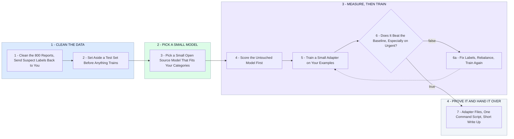

# How I Fine Tune Your Medical Report Classifier

- **1 - CLEAN THE DATA** - Duplicates out, formatting fixed, suspicious labels sent back to you. A test set is set aside first so the results are honest.
- **2 - PICK A SMALL MODEL** - An existing lightweight open source model, not one built from scratch. Cheap to run, fast to train.
- **3 - MEASURE, THEN TRAIN** - Score the untouched model first so the before number is real. Then train a small adapter on your examples.
- **4 - PROVE IT AND HAND IT OVER** - Same test set, before vs after, per category. You get the adapter files, a one command script, and a short write up.
