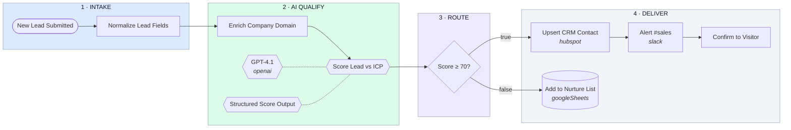

# Inbound Lead → AI Qualify → CRM → Slack

- **1 · INTAKE** — Every inbound lead — website form, landing page, or ad — lands on one webhook and is normalised into a single shape before anything downstream touches it.
- **2 · AI QUALIFY** — The company domain is enriched, then an AI agent scores fit against your ICP and writes a one-line rationale the rep can read at a glance.
- **3 · ROUTE** — Scored leads split: qualified leads go straight to the CRM and the sales channel, everything else drops into a nurture list instead of the reps' queue.
- **4 · DELIVER** — The CRM record is created or updated, the rep is notified with the score and rationale attached, and the webhook answers the form so the visitor sees an instant confirmation.
