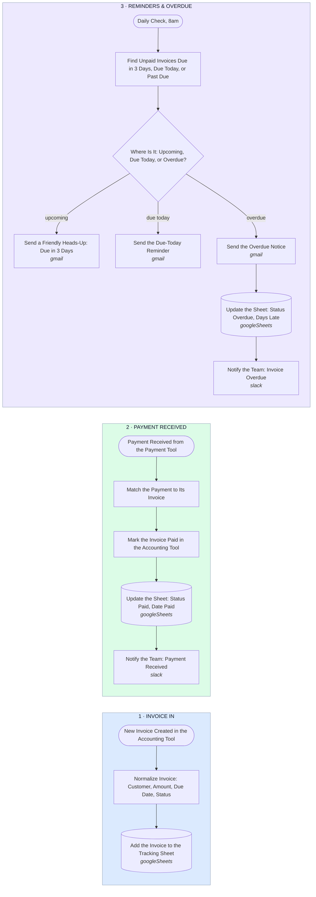

# Invoice & Payment Tracking — Invoice In → Status Sync → Reminders → Overdue Alerts

- **1 · INVOICE IN** — Every new invoice lands in the tracking sheet the moment it's created, so the sheet is the single source of truth, not a weekly export.
- **2 · PAYMENT RECEIVED** — A payment gets matched to its invoice and marked paid everywhere at once, accounting tool, sheet, and team, so no one chases an invoice that's already settled.
- **3 · REMINDERS & OVERDUE** — A daily check sends the right message for where each invoice actually is, upcoming, due today, or overdue, and the team only hears about the overdue ones.
