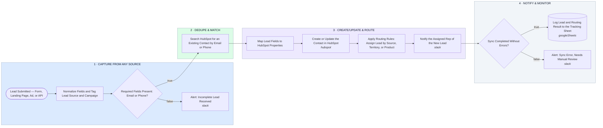

# Lead Capture → Dedupe → HubSpot Sync → Route → Monitor

- **1 · CAPTURE FROM ANY SOURCE** — One webhook accepts leads from forms, landing pages, ads, or a direct API call, and bad submissions get caught before they touch the CRM.
- **2 · DEDUPE & MATCH** — Every lead gets checked against HubSpot by email or phone before anything is written, so the next step knows whether to create or update.
- **3 · CREATE/UPDATE & ROUTE** — Fields map to the right HubSpot properties, source and campaign get tagged, and the lead is routed by the rules you set.
- **4 · NOTIFY & MONITOR** — The assigned rep gets notified, every run gets logged, and a failed sync alerts instead of silently disappearing.
