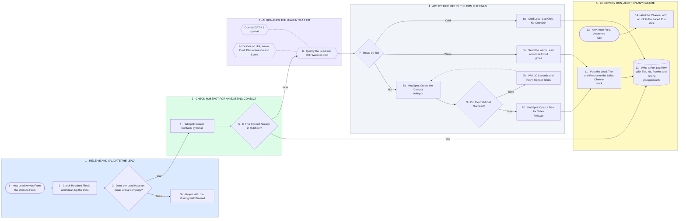

# Lead In → AI Tier → HubSpot With Retries → Slack → Run Log

- **1 · RECEIVE AND VALIDATE THE LEAD** — Every lead is checked before anything downstream runs. A bad payload is rejected with the missing field named, not failed halfway through.
- **2 · CHECK HUBSPOT FOR AN EXISTING CONTACT** — One search by email before we create anything. A returning contact is logged and never duplicated in the CRM.
- **3 · AI QUALIFIES THE LEAD INTO A TIER** — OpenAI reads the form answers and company details and returns one of Hot, Warm or Cold with a reason. The parser forces the shape so the switch below never gets free text.
- **4 · ACT BY TIER, RETRY THE CRM IF IT FAILS** — Hot goes straight into HubSpot as a contact plus a deal. Warm gets a nurture email. Cold is logged only. If HubSpot errors or rate limits, we wait and retry up to three times before giving up.
- **5 · LOG EVERY RUN, ALERT ON ANY FAILURE** — Sales sees every qualified lead in Slack. Every run writes a log row with tier, ids and timing. Anything that breaks anywhere pings the channel with a link to the failed execution.
