# Lead/Inquiry Capture → AI Score & Draft → Dynamics CRM → Route Sales or Support

```mermaid
flowchart LR
    subgraph sec_capture["1 · CAPTURE & ORGANIZE"]
        direction TB
        trig(["New Lead or Inquiry Received"])
        normalize["Normalize Contact Info and Message"]
        check_dup["Check Dynamics CRM for an Existing Record"]
    end
    subgraph sec_score["2 · AI SCORE & DRAFT"]
        direction TB
        score_agent{{"Score the Lead, Classify Sales vs Support, and Draft a First Response"}}
        score_model{{"GPT-4.1<br/><i>openai</i>"}}
    end
    subgraph sec_sync["3 · SYNC TO DYNAMICS"]
        direction TB
        upsert_dynamics["Create or Update the Record in Dynamics CRM"]
        log_activity["Log the Interaction and Drafted Response as an Activity"]
    end
    subgraph sec_route["4 · ROUTE SALES OR SUPPORT"]
        direction TB
        intent_branch{"Classified as Sales-Ready or Support Request?"}
        notify_sales["Notify Sales Rep: New Qualified Lead<br/><i>slack</i>"]
        route_support["Route to Support Queue for Review<br/><i>slack</i>"]
        send_response["Send the Drafted Response to the Contact<br/><i>gmail</i>"]
    end
    trig --> normalize
    normalize --> check_dup
    check_dup --> score_agent
    score_agent --> upsert_dynamics
    upsert_dynamics --> log_activity
    log_activity --> intent_branch
    intent_branch -->|true| notify_sales
    intent_branch -->|false| route_support
    notify_sales --> send_response
    route_support --> send_response
    score_model -.- score_agent
    style sec_capture fill:#dbeafe,stroke:#94a3b8,color:#0f172a
    style sec_score fill:#dcfce7,stroke:#94a3b8,color:#0f172a
    style sec_sync fill:#ede9fe,stroke:#94a3b8,color:#0f172a
    style sec_route fill:#f1f5f9,stroke:#94a3b8,color:#0f172a
```

- **1 · CAPTURE & ORGANIZE** — Every inquiry gets normalized and checked against Dynamics before anything else happens, so nothing becomes a duplicate record.
- **2 · AI SCORE & DRAFT** — One AI step classifies whether this is a sales lead or a support need and drafts the first response either way.
- **3 · SYNC TO DYNAMICS** — The record and the interaction both get logged, so the CRM stays the source of truth, not a spreadsheet on the side.
- **4 · ROUTE SALES OR SUPPORT** — Sales-ready leads notify a rep, support requests go to the queue, and the drafted response goes out either way.
