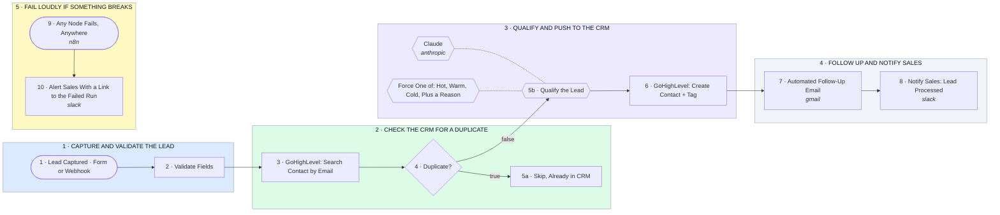

# Lead → Validate → Dedupe → AI Qualify → GHL → Email → Slack

- **1 · CAPTURE AND VALIDATE THE LEAD** — One lead comes in from a form or any webhook. Missing email or a bad phone throws with a clear reason, so nothing half-broken reaches the CRM.
- **2 · CHECK THE CRM FOR A DUPLICATE** — Search GoHighLevel by email before creating anything. Swapping to Zoho CRM is the same two HTTP calls with different endpoints.
- **3 · QUALIFY AND PUSH TO THE CRM** — Claude reads the lead and returns hot, warm, or cold plus a one-line reason. The contact is created with that tag so sales can filter on it.
- **4 · FOLLOW UP AND NOTIFY SALES** — The lead gets a same-minute email. Sales gets one message with the score, the reason, and the CRM link.
- **5 · FAIL LOUDLY IF SOMETHING BREAKS** — Any node failing anywhere posts an alert with a link to the run. Nothing fails silently.
