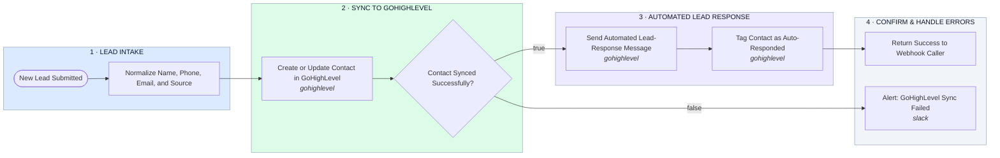

# Lead Webhook → GoHighLevel Sync → Automated Response

- **1 · LEAD INTAKE** — Catches the lead from its source and normalizes the fields before anything touches GoHighLevel.
- **2 · SYNC TO GOHIGHLEVEL** — Creates or updates the contact in GoHighLevel over its webhook API.
- **3 · AUTOMATED LEAD RESPONSE** — Fires the automated response and tags the contact once the sync succeeds.
- **4 · CONFIRM & HANDLE ERRORS** — Returns a success confirmation, or alerts if the GoHighLevel sync failed.
