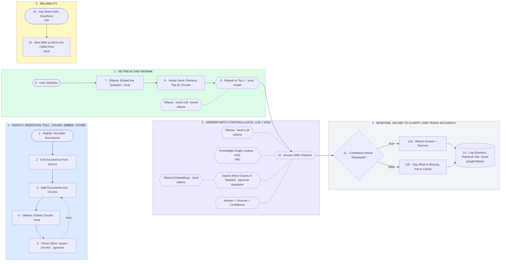

# Local RAG Pipeline: Ollama Embeddings, Rerank, Cited Answers

- **1 · NIGHTLY INGESTION: PULL, CHUNK, EMBED, STORE** — Every night the source documents are pulled, cut into chunks, embedded on a local Ollama model and written to the vector store. Nothing leaves the box.
- **2 · RETRIEVE AND RERANK** — The question is embedded the same way, the 20 nearest chunks come back, and a local model reranks them to the 5 that actually answer it.
- **3 · ANSWER WITH CITATIONS (LOCAL LLM + KAG)** — The agent answers only from the reranked chunks and the knowledge graph. It has to return sources and a confidence score, not just text.
- **4 · RESPOND, OR ASK TO CLARIFY, AND TRACK ACCURACY** — Confident answers go back with sources. Weak ones say what is missing. Every question is logged so accuracy can be measured week over week.
- **5 · RELIABILITY** — Any failure anywhere raises an alert with a link to the run. Nothing fails silently.
