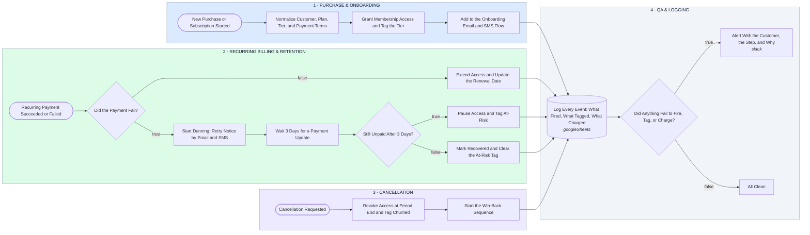

# Membership Lifecycle — Purchase → Onboarding → Recurring Billing → Retention → Cancellation, Fully Logged

- **1 · PURCHASE & ONBOARDING** — A new purchase grants access, tags the tier, and starts onboarding in one pass, so no one is paying without access or getting access without paying.
- **2 · RECURRING BILLING & RETENTION** — Every renewal either extends access or starts dunning, with a real wait before access is paused, that's the retention step most setups skip.
- **3 · CANCELLATION** — Access ends at period end, not the moment they click, and the win-back sequence starts automatically.
- **4 · QA & LOGGING** — Every event logs what fired, what tagged, and what charged, and anything that didn't gets flagged immediately, that's how you find out before the customer does.
