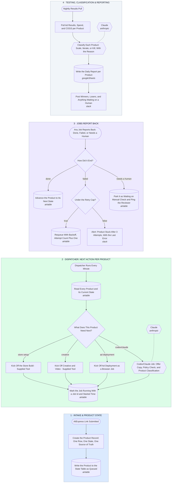

# Multi-Product Orchestrator — State Table → Dispatcher → Parallel Jobs → Results, Retries, Manual Holds → Nightly Classification

- **1 · INTAKE & PRODUCT STATE** — Every product gets one row in a state table the moment its link comes in. That row is the only source of truth for where it is, so products can never interfere with each other.
- **2 · DISPATCHER: NEXT ACTION PER PRODUCT** — A dispatcher reads every product's state each minute and kicks off whatever that product needs next, store, creative, ads, or a Codex/Claude job, in parallel across products.
- **3 · JOBS REPORT BACK** — Every job, however long it runs, reports back through one door. Done advances the product, failed retries with backoff up to a cap, and needs-a-human parks it and pings the reviewer.
- **4 · TESTING, CLASSIFICATION & REPORTING** — Nightly, real ad results and COGS come in per product and get classified scale, iterate, or kill, so the next morning's dispatcher is already acting on it.
