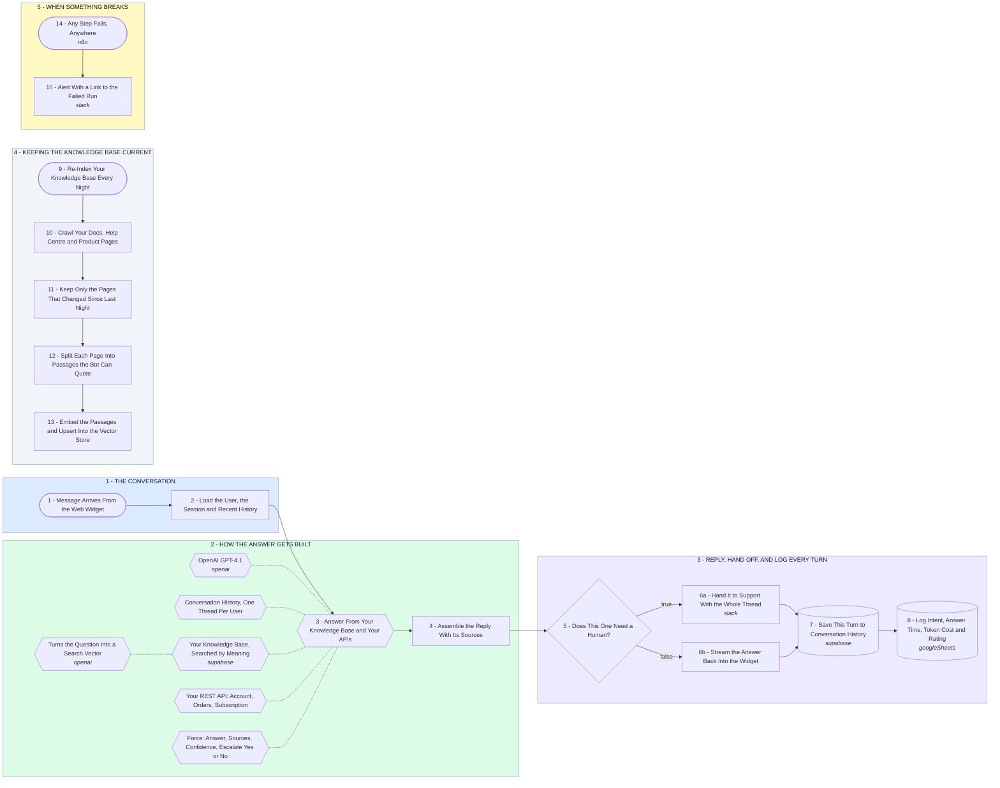

# Production AI Chatbot Backend - RAG, Memory, Analytics

- **1 - THE CONVERSATION** - Every message arrives with a user id and a session id, so the bot knows who it is talking to before it thinks.
- **2 - HOW THE ANSWER GETS BUILT** - One agent, with your knowledge base and your REST API attached to it. It has to cite where the answer came from.
- **3 - REPLY, HAND OFF, AND LOG EVERY TURN** - Low confidence goes to a human with the full thread. Everything else streams back and gets written down either way.
- **4 - KEEPING THE KNOWLEDGE BASE CURRENT** - Runs on its own every night. This is the part that stops the bot answering from last quarter's docs.
- **5 - WHEN SOMETHING BREAKS** - A failed run pings me with a link to it. Nothing fails quietly in front of a customer.
