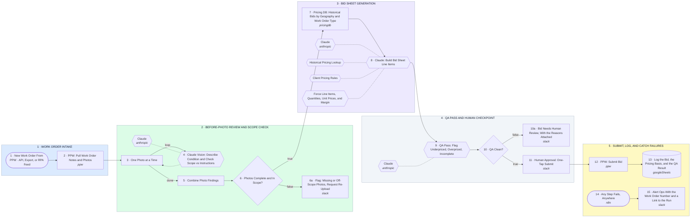

# Property Preservation Pilot: Photo Review, Bid Build, QA, Submit

- **1 · WORK ORDER INTAKE** — One work order type to start. The feed from PPW is a swappable first step: API if they expose one, scheduled export if not, browser automation as the fallback. Discovery decides which.
- **2 · BEFORE-PHOTO REVIEW AND SCOPE CHECK** — Every before-photo is described and checked against the work order instructions. Missing or off-scope photos go back to the contractor before anyone builds a bid. Phase 2 runs the same pattern on after-photos once work is approved and completed.
- **3 · BID SHEET GENERATION** — The bid is built from the photo findings, the measurements, and historical bids for that geography and work order type. Client pricing rules and target margin are tools the model has to call, not text in a prompt.
- **4 · QA PASS AND HUMAN CHECKPOINT** — A second model reviews the bid for underpriced, overpriced, or incomplete lines. Nothing reaches a client until a person taps approve. The checkpoint stays even after the QA pass earns trust.
- **5 · SUBMIT, LOG, AND CATCH FAILURES** — The approved bid goes back into PPW and every line is logged with the pricing it was based on, so the pricing model gets better with each order. "Ready for office" routing after verification is Phase 2 on this same pattern.
